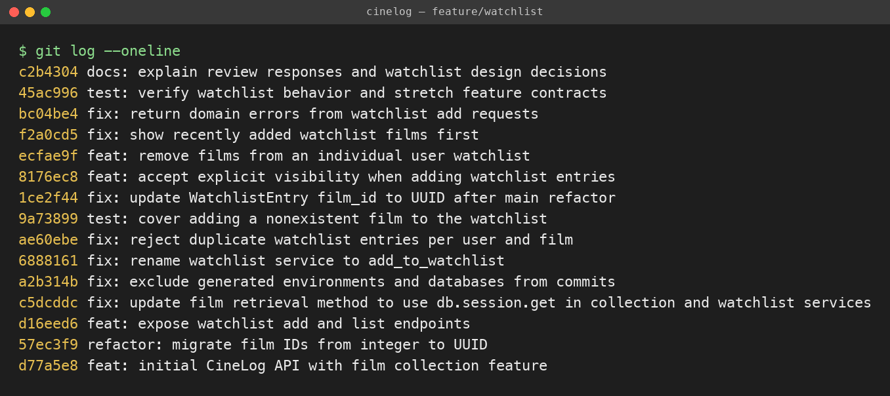

# PR Response Doc — CineLog Watchlist Feature

## AI Usage

Brian directed Codex to prepare and submit this project through his GitHub account. Codex read `models.py`, `services/collection_service.py`, and `tests/test_collection.py`, then inspected all six maintainer comments on [CodePath PR #1](https://github.com/codepath/ai201-project6-cinelog-starter/pull/1). It implemented the rename, deduplication, UUID follow-up, endpoint handling, stretch features, and tests; ran the tests and live HTTP checks; resolved the rebase conflict; and helped write this document. This was substantial AI implementation assistance, including the deduplication code, rather than orientation assistance alone.

Brian explicitly chose **public by default** and **date-added sorting**, explaining that time is more relevant and asking Codex to challenge that choice if alphabetical ordering was preferable. Codex raised known-title lookup and older-item visibility as counterarguments and expanded the written tradeoff explanations below. The decisions and recency rationale came from Brian; the detailed prose and public-default rationale were AI-assisted. No user research or measured preference is claimed. Codex also reviewed the commit messages against the [Conventional Commits specification](https://www.conventionalcommits.org/en/v1.0.0/) and the repository's `CONTRIBUTING.md`.

## Comment 1 — Rename

**What I did:** Renamed `save_to_watchlist()` to `add_to_watchlist()` in `services/watchlist_service.py`. Updated both the import and the endpoint call in `routes/watchlist/watchlist.py`, following the `add_to_collection()` naming pattern.

**How I verified:** Searched all tracked Python files for both function names. The original name has no remaining Python references; the service definition, route import, endpoint call, and new tests consistently use `add_to_watchlist`. The full collection suite passed after the rename, and the final endpoint tests exercise the updated call site.

## Comment 2 — Deduplication

**What I did:** Used `add_to_collection()` in `services/collection_service.py` as the pattern. It first confirms that the film exists, then calls `CollectionEntry.query.filter_by(user_id=user_id, film_id=film_id).first()`. If a matching pair exists, it raises `AlreadyInCollectionError` before adding or committing a row. The watchlist now performs the same pair-specific check and raises `AlreadyInWatchlistError`. The add endpoint translates this to HTTP 409 with a JSON error.

**Why:** A film may appear on several users' watchlists, but adding the same film twice for the same user should fail. Checking only `film_id` would incorrectly block other users. Checking before the insert preserves the existing entry and its visibility.

**How I verified:** `test_add_to_watchlist_duplicate_raises` adds a film twice, expects the domain exception, and verifies exactly one matching row remains. `test_same_film_can_belong_to_two_users` confirms the check is scoped to the owner. The full suite passed after this fix; the live API also returned 409 on a repeated add.

## Comment 3 — Missing test

**What I did:** Added `tests/test_watchlist.py`, modeled on `test_add_to_collection_nonexistent_film_raises`. The fixtures create an isolated in-memory database and a persisted sample user. Inside the app context, the test calls `add_to_watchlist` with the absent all-zero UUID and uses `pytest.raises(FilmNotFoundError)`. It also verifies that no watchlist row was created.

**How I verified:** Both `python -m pytest tests/test_watchlist.py -v` and `python -m pytest tests/ -v` passed at this milestone: one watchlist test and five total. The final suite has 17 passing cases. The HTTP test confirms the add endpoint returns 404 for an unknown film.

## Comment 4 — Default visibility

**My position:** Keep `public=True` as an intentional default. Brian selected this option directly.

**Reasoning:** CineLog is a community film-tracking app, and a watchlist captures films someone is interested in watching rather than only films they have already reviewed. Public entries can give other community members a starting point for discussing a film or suggesting what to watch together. A default that requires no extra action to share supports that use. The existing collection model also has no per-entry privacy setting, so this choice is consistent with the starter's community-oriented collection behavior. These are product judgments, not claims that a discovery feed or recommendation system already exists.

**Tradeoff acknowledged:** Private-by-default would better protect users who regard tentative viewing interests as personal. Public visibility can surprise someone who assumes a saved-for-later list is private. The explicit `public: false` option provides an opt-out for each new entry, but it does not eliminate the risk that someone misses the default. A production interface should clearly show the visibility choice before saving.

**Scope:** This starter stores and returns visibility metadata. It has no authenticated viewer context or authorization layer, so `public=False` is not a claim of enforced access control. Production privacy enforcement is additional work.

## Comment 5 — Sort order

**My position:** Accept date-added order, newest first. Brian's reason was that time is more relevant. The code now orders by `WatchlistEntry.date_added.desc()`, using film title ascending only to break equal timestamps.

**Reasoning:** Someone using CineLog to save a film after hearing about it can return to the watchlist and find that recent intention at the top, even if they cannot recall the exact title. In a list containing both older plans and films just recommended, date added preserves the recent context that motivated the save. It also matches `get_collection()`'s existing newest-first order, reducing the need to learn two default ordering rules.

**Engagement with the reviewer's point:** The maintainer argues that most users want recent additions first. I agree with prioritizing that workflow, while treating the statement about most users as a hypothesis rather than measured evidence. Alphabetical ordering has a real advantage for finding a remembered title and gives old saves a stable position; newest-first can bury older intentions. For the default, recent intent is the stronger priority here. Alphabetical sorting could be offered later as an explicit alternate mode. It is not implemented as a separate mode in this change.

**How I verified:** `test_watchlist_returns_newest_first_with_title_tiebreak` creates explicit old and new timestamps and verifies chronological ordering plus deterministic title order for a tie. A live HTTP check added Alien before Paddington 2 and returned Paddington 2 first, proving that the result is not alphabetical.

## Comment 6 — Rebase

**What conflicted:** `git rebase origin/main` stopped in `models.py` while replaying the original feature commit. Main used `db.String(36)` for `WatchlistEntry.film_id`, while the feature commit still used indexed `db.Integer`.

**How I resolved it:** Retained main's UUID-compatible string foreign key, removed the conflict markers, staged `models.py`, and ran `git rebase --continue`. A separate `fix:` commit explicitly names the UUID update: it preserves the feature's index on the UUID column and corrects the service and route documentation from integer IDs to film UUIDs. Incoming UUID strings pass through without integer conversion.

**How I verified no conflict remains:** All 17 tests passed after the rebase. The UUID persistence test parses the saved film ID with `uuid.UUID` and reads it back from the database. The full live API add/list/remove cycle used actual seeded UUIDs. `git diff --check` passed, `git merge-base --is-ancestor origin/main HEAD` succeeded, and `git rev-list --count --merges origin/main..HEAD` returned zero. A tracked-source scan found no conflict markers.

## Stretch Features

- **Remove from watchlist:** Added `remove_from_watchlist(user_id, film_id)`, matching `remove_from_collection()`'s owner-and-film query, delete, commit, and `True` return. An absent entry raises `NotInWatchlistError`; the DELETE endpoint returns 404. `test_remove_from_watchlist_preserves_other_users_entry` verifies successful removal, repeat-removal failure, and preservation of another user's entry for the same film.
- **Additional edge case:** Added a separate `test:` commit beyond Comment 3. In particular, `test_same_film_can_belong_to_two_users` protects against accidentally treating deduplication as a global film restriction. Other tests cover UUID persistence, date ordering, visibility, and HTTP errors.
- **Visibility toggle:** The service and POST endpoint accept optional `public`, defaulting to `True`. Send `{"film_id":"<film UUID>","public":false}` to create a private-marked entry. Explicit true and false round-trip through add and list; non-boolean values return 400 without inserting a row.

## Commit History

Used an interactive rebase over `origin/main..HEAD` to reword the starter's vague feature message and make the generated-file exclusion message explicit. Rename, deduplication, missing-film test, UUID follow-up, visibility, removal, sorting, endpoint errors, and further tests remain distinct commits. Codex checked the messages for conventional prefixes, imperative summaries, and logical scope. The inherited lookup modernization changes the collection and watchlist lookup together as one API modernization.



The screenshot shows the history before the final documentation/image commit, which adds this evidence to the branch without rewriting the displayed commits.

## Final Verification

- `python -m pytest tests/ -v`: **17 passed**.
- Real HTTP requests against a seeded Flask server: add 201, duplicate 409, missing film 404, list 200 in newest-first order, explicit false/default true preserved, remove 200, and repeat remove 404.
- No merge commits, no tracked conflict markers, and no whitespace errors.
- Public is a stored visibility flag; authentication and privacy enforcement are outside this starter's implementation.

## PR Description

CineLog users can save films they plan to watch, retrieve their watchlist with visibility metadata, and remove saved films. This change completes the watchlist review cycle: consistent service naming, per-user deduplication, missing-film coverage, UUID compatibility after rebasing on main, and all three stretch features.

**Design decisions:** Keep public visibility by default to support the community's sharing workflow, with an explicit `public: false` option. Use date-added descending because recent saves retain the most relevant viewing intent; film title breaks timestamp ties. Visibility remains metadata in this unauthenticated starter.

**Manual testing:**

1. Check out `feature/watchlist`, create and activate a virtual environment, and run `python -m pip install -r requirements.txt`.
2. On a fresh local database, run `python seed.py`. Copy the printed demo user UUID into `USER_ID`. Run `python app.py` in another terminal; the API listens at `http://127.0.0.1:5000`.
3. Run `curl http://127.0.0.1:5000/films/`. Copy Alien's UUID into `FILM_A` and Paddington 2's UUID into `FILM_B`.
4. Add Alien with explicit visibility:
   ```bash
   curl -i -X POST "http://127.0.0.1:5000/watchlist/$USER_ID/add" \
     -H 'Content-Type: application/json' \
     -d "{\"film_id\":\"$FILM_A\",\"public\":false}"
   ```
   Expect 201 and `public: false`. Repeat the request; expect 409 and no extra entry.
5. Add Paddington 2, omitting visibility:
   ```bash
   curl -i -X POST "http://127.0.0.1:5000/watchlist/$USER_ID/add" \
     -H 'Content-Type: application/json' -d "{\"film_id\":\"$FILM_B\"}"
   curl "http://127.0.0.1:5000/watchlist/$USER_ID"
   ```
   Expect 201 with `public: true`, then a list with Paddington 2 before Alien despite alphabetical order.
6. POST the all-zero UUID as `film_id`; expect 404. POST a valid film with `"public":"false"` (a string); expect 400. POST `{}`; expect 400.
7. Remove Alien:
   ```bash
   curl -i -X DELETE "http://127.0.0.1:5000/watchlist/$USER_ID/remove" \
     -H 'Content-Type: application/json' -d "{\"film_id\":\"$FILM_A\"}"
   ```
   Expect 200 with `removed: true`; repeat and expect 404. GET the list and confirm only Paddington 2 remains.
8. Run `python -m pytest tests/ -v`; expect 17 passing cases. Review `pr-response.md` for all six responses, AI assistance, and the commit-history screenshot.
